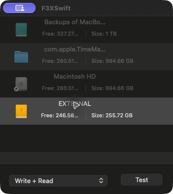
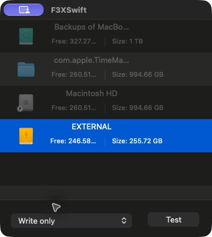
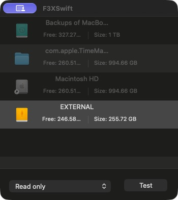

# F3XSwift SSD

A free, open-source macOS app for checking the usable capacity of external SSDs, USB flash drives and memory cards. It writes test files and reads them back using the bundled [F3 — Fight Flash Fraud](https://github.com/AltraMayor/f3) tools. Homebrew is not required.

This is an SSD-focused fork of [Volker Runkel's F3XSwift](https://github.com/vrunkel/F3XSwift), which is based on [F3X](https://github.com/insidegui/F3X) and F3. Original attribution and the GPL-3.0 license are retained.

## Download

**[Download the latest macOS release](https://github.com/Delitants/F3XSwift/releases/latest)** and extract the Apple Silicon ZIP. Move **F3XSwift SSD.app** into Applications and open it.

- macOS 13 or later.
- The downloadable build is native **Apple Silicon / arm64**.
- F3 v10.0 `f3write` and `f3read` are included.
- The app is locally ad-hoc signed, not Apple notarized.

## Screenshots

The main window with **Write + Read** selected:



| Write only | Read only |
| --- | --- |
|  |  |

## Test modes

| Mode | What it does |
| --- | --- |
| **Write + Read** | Writes test files into the selected volume's free space, then verifies them. |
| **Write only** | Writes test files and stops, leaving them available for later verification. Writing alone does not verify capacity. |
| **Read only** | Verifies existing `.h2w` files without running the writer. |

Choose a mounted external volume, select a mode, and press **Test**. Confirm access to that exact volume in the macOS file panel. [Usage details](docs/usage.md)

**Back up first.** These tests fill free space, and a counterfeit drive can corrupt existing data. Use an empty volume to check nearly its full capacity. Read-only mode requires files previously created by F3.

## SSD selection and large drives

External SSDs can report `volumeIsEjectable = false`, which made them unavailable in the original app. This fork checks that a volume is local, external and writable instead. Internal, network, read-only and unidentified volumes remain disabled.

**1 TB, 2 TB and larger volumes are supported by the engine's 64-bit size and offset counters.** F3 creates successive 1 GiB files until the selected volume's free space is exhausted. There is no 1 GiB test limit in the app. Partitions are tested separately, and larger tests take proportionally longer. Keep the drive connected and the Mac awake until the test finishes.

## Build from source

Requires Xcode. From this repository:

```sh
xcodebuild -project F3XSwift.xcodeproj -scheme F3XSwift \
  -configuration Release -derivedDataPath build/DerivedData \
  -destination 'generic/platform=macOS' ARCHS=arm64 \
  CODE_SIGN_IDENTITY=- CODE_SIGN_STYLE=Manual DEVELOPMENT_TEAM= \
  ENABLE_USER_SCRIPT_SANDBOXING=NO CODE_SIGN_INJECT_BASE_ENTITLEMENTS=NO build
```

The app is at `build/DerivedData/Build/Products/Release/F3XSwift.app`. Rename it to `F3XSwift SSD.app` if desired. The project includes the F3 helpers, so Homebrew is not needed to build or use the app.

## Verification

The standalone tests compile the production runner, process wrapper, result parser and volume-selection code:

```sh
mkdir -p build/tests
xcrun swiftc -module-cache-path build/ModuleCache \
  F3XSwift/RunningF3/VRTask.swift F3XSwift/RunningF3/F3SRunner.swift \
  F3XSwift/Results/F3STestResults.swift Tests/TestModeTests.swift \
  -o build/tests/test-modes
build/tests/test-modes "$PWD/build/mode-test-data" "$PWD/f3build"

xcrun swiftc -module-cache-path build/ModuleCache \
  F3XSwift/VolumeHandling/F3VolumeDataSource.swift \
  F3XSwift/VolumeHandling/F3Volume.swift F3XSwift/Results/F3STestResults.swift \
  Tests/VolumeEligibilityTests.swift -o build/tests/test-volumes
build/tests/test-volumes
```

The mode tests write a bounded 1 GiB file in the specified workspace directory. They check phase selection with the real F3 tools, unchanged data in read-only mode, failure handling and terabyte-scale result parsing. The volume test optionally accepts an external volume path and inspects its metadata without writing to it.

Release validation also exercised a bounded F3 file at logical offset 2 TiB and checked the native GUI's mode selector and SSD selection. These checks do not establish the capacity or health of any particular physical drive; run a full test on the drive to determine that.

## License and sources

[GPL-3.0](LICENSE). F3XSwift SSD changes are maintained in this fork. The bundled F3 v10.0 helpers come from upstream F3XSwift; their engine source is available at [F3 v10.0](https://github.com/AltraMayor/f3/tree/v10.0). See [third-party notices](THIRD-PARTY-NOTICES.md).
